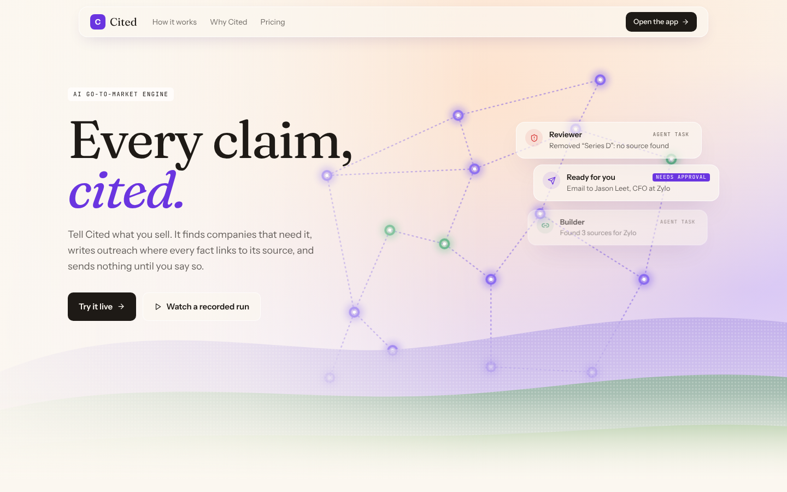
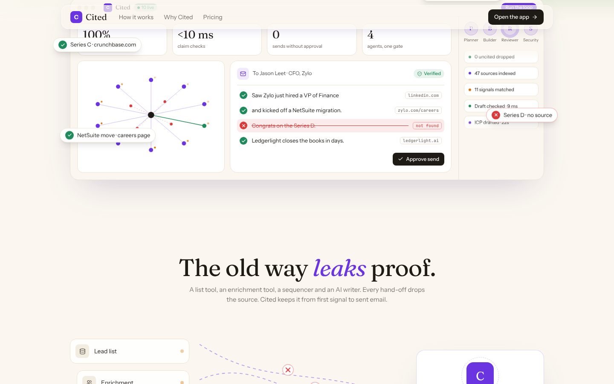
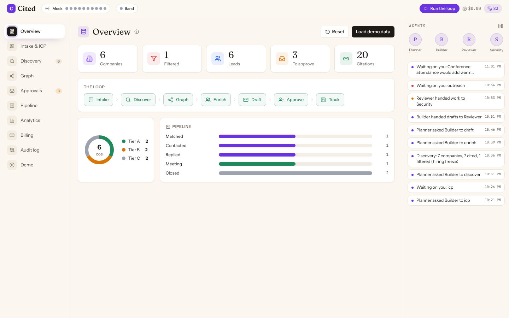
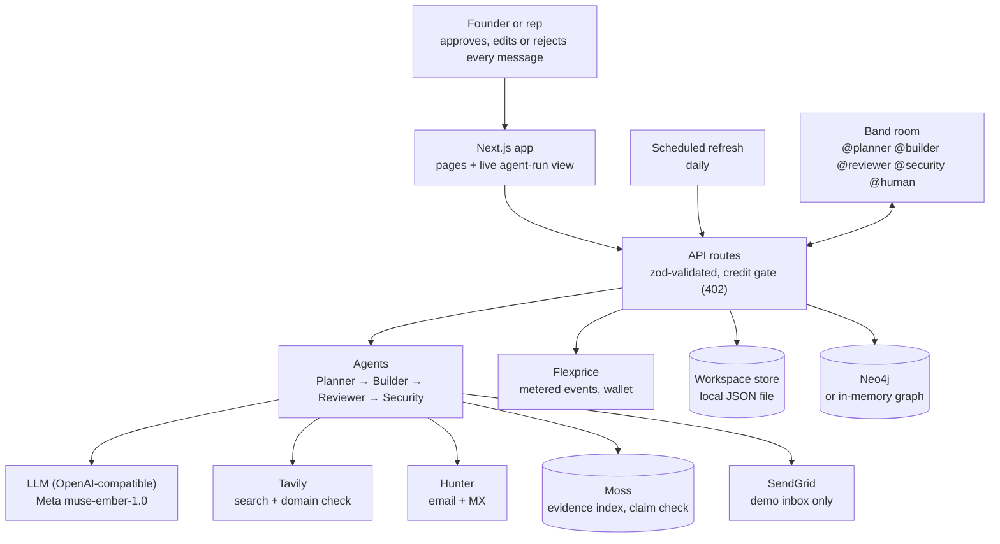
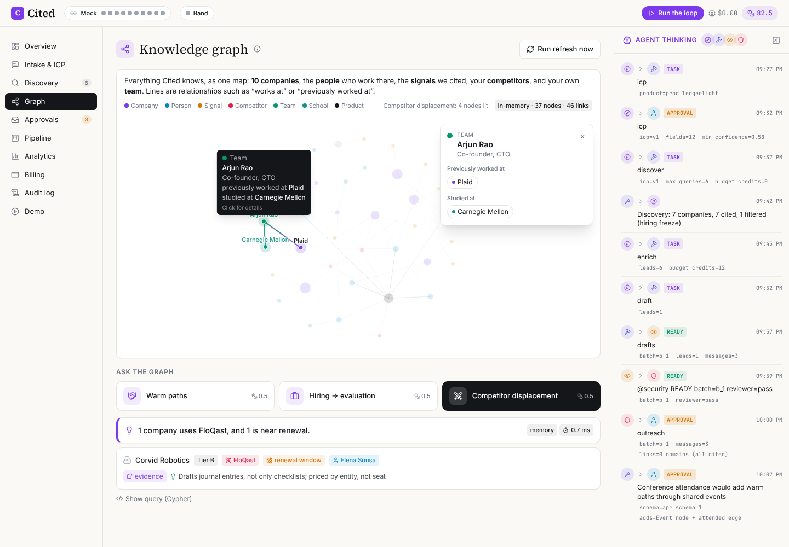

# Cited

**Every claim, cited.**

Cited helps a B2B founder with no sales team find the right companies, reach the right person, and send outreach they can stand behind. You describe your product in a couple of lines. Cited works out who should buy it and finds real companies that fit, each with the web page that shows why. It finds the buyer, drafts emails where every fact links back to a source, and sends nothing until you approve it.

The idea behind the name: sales email is full of claims ("congrats on the Series C", "saw you're hiring a controller"). If one of those is wrong, the email is worse than no email. So Cited keeps the source for every fact from the moment it is found to the moment it is sent, and it refuses to let a sentence through if it can't point to where that fact came from.



## Demo

- **Live site:** _Vercel link coming_
- **Run it yourself:** see [Running it](#running-it). Live mode uses real data only.

| A draft being checked line by line | The app |
|---|---|
|  |  |

## System architecture



The browser never talks to a vendor. Every vendor call goes through an adapter in `lib/providers/`, and every action that costs money passes the credit gate first. More detail, including every Cypher query, is in [docs/system-design.md](docs/system-design.md).

Other docs: [demo script](docs/demo-script.md).

## The problem we were given, and how Cited answers it

The brief asked for an AI go-to-market engine in five modules, plus optional integrations. Here is what we built for each, and the logic behind it.

### Module 1: Product intake and ICP

**What you do:** describe the product in a short chat, or fill in a form. Only the name and a one-line description are required. Customers, pricing, regions, team background and constraints sit under "Advanced".

**What Cited does** (`lib/pipeline/icp.ts`, `app/(app)/intake`):

- The LLM turns the description into a structured ideal customer profile: industries with NAICS codes, company size range, regions, buyer personas with seniority, buying triggers (for example "new CFO" or "ERP migration"), and negative signals (for example "hiring freeze").
- Every field has a confidence score from 0.00 to 1.00. The prompt tells the model to score guesses under 0.55, and the UI shows low-confidence fields in amber so you know what to check.
- It also suggests adjacent segments ("expansion"), each with a reason and a search query. You accept, adjust or dismiss each one. Accepted segments become the first discovery queries.
- Nothing downstream runs until you approve the ICP. Approving it versions it (v1, v2, …).

### Module 2: Customer and competitor discovery

**Finding companies** (`lib/pipeline/discovery.ts`, `citations.ts`, `scoring.ts`):

1. The LLM writes up to 6 short search queries from the approved ICP and triggers.
2. Tavily runs all of them in parallel. Results are deduplicated by URL.
3. The LLM extracts companies and signals from the results. It is told to only name companies that appear in the results and to copy URLs exactly. Large result sets are split into chunks and extracted in parallel.
4. **Citation check.** Every company and every signal must point at a URL that the search actually returned. Anything else is dropped and logged as "uncited". This is code, not a prompt: the model cannot invent a source.
5. **Domain check.** A company's domain must appear in one of its cited URLs, or be confirmed by a search restricted to that domain. It is never guessed from the name.
6. **Negative filter.** Companies with a negative signal (hiring freeze, layoffs) or in an excluded region are kept but marked as filtered, with the reason shown.
7. **Scoring.** `score = 0.6 × fit + 0.4 × intent`.
   - Fit: industry match (exact NAICS beats same sector), headcount inside the ICP range, and region match.
   - Intent: matching trigger signals, discounted by age (full weight under 30 days, 0.7 up to 90 days, 0.4 after).
   - Tiers: A ≥ 75, B ≥ 55, otherwise C.

**Competitors.** A separate search maps direct, adjacent and status-quo alternatives, such as spreadsheets. Each has its positioning, published pricing, our advantage, and a source URL that must come from the search results. This runs at the same time as lead discovery.

### Module 3: Knowledge graph

**Schema** (`lib/graph/schema.cypher`, `lib/graph/model.ts`):

- **Nodes:** Company, Person, Product, Competitor, Signal, Team (our own team members) and School.
- **Edges:** `works_at`, `competes_with`, `matched_to`, `contacted_via`, `replied_to`, `previously_employed_at`, `has_signal`, `uses` and `studied_at`.

The graph is mirrored to Neo4j after every change. Node ids match the workspace ids, so the two never drift. If Neo4j is not configured or a query fails, the same query runs on an in-memory copy of the graph, and the page says so with a small badge.

**Three multi-hop queries** (`lib/graph/queries.ts`), each with a plain-English answer on the Graph page:




| Query | What it finds |
|---|---|
| Warm paths | Someone on your team and a buyer who share a past employer or school, and which company that buyer works at now |
| Hiring → evaluation | Companies hiring for the role that would evaluate a tool like yours, alongside signals such as funding or a new system |
| Competitor displacement | Companies using a competitor you beat, with the evidence and whether a renewal is coming up |

**Keeping it fresh.** Signals refresh on a schedule (dailyours in `vercel.json`, or with the "Run refresh now" button). A refresh re-scores and re-tiers companies, and a new negative signal withdraws any unsent drafts for that company.

### Module 4: Enrichment and outreach

**Enrichment** (`lib/pipeline/enrich.ts`). Hunter finds the buyer's work email for the company domain and checks deliverability and MX records. Each field records where it came from, so the UI can show "Hunter" next to an email. The adapter for Apollo (LinkedIn URL, HQ, career history) exists, but we didn't use it in the live demo (see "Known limits").

**Drafting** (`lib/pipeline/outreach.ts`):

- **The sequence.** Each lead gets three touches: an email on day 0, a LinkedIn note on day 2 and a follow-up email on day 5.
- **Evidence.** Before drafting, Cited pulls that company's stored evidence from Moss: cited pages, signals and firmographics. The draft is written from that evidence. Touch 1 must reference a real signal by id.
- **Reviewer** (`lib/agents/reviewer.ts`). This is a rules check, not another LLM. It enforces word limits by seniority (shorter for executives, 60 words on LinkedIn), bans a list of buzzwords and em dashes, allows at most one question (one call to action), and requires a subject on emails.
- **Claim check** (`lib/pipeline/evidence.ts`):
  1. Every sentence that states a fact (numbers, funding, hires, product names) is searched against the evidence in Moss.
  2. A sentence counts as supported only if a matching piece of evidence scores above the threshold and contains the same hard facts.
  3. This takes a few milliseconds per sentence.
  4. Unsupported sentences are flagged. If you edit a draft and add an unsupported claim, approval is refused with `422 UNCITED_CLAIM`.
- **Fix round.** If the reviewer or the claim check finds problems, the draft goes back to the LLM once with the specific findings. Whatever still fails is marked "needs fix" for a human.
- **Security** (`lib/agents/security.ts`) checks every link in a draft against domains we actually cited. Unknown links are blocked.
- **Speed.** Leads are drafted four at a time, and the claim checks for a lead's three touches run in parallel.

**Approval gate** (`lib/pipeline/decide.ts`):

- Drafts arrive in the Approval queue as one batch. You can approve all of them, reject some with a reason (the reason goes back to the builder agent), or edit and approve one at a time.
- The send function refuses anything that is not in the approved state. That is a hard block in code, and it raises an alert.
- **Email safety** (`lib/providers/sendgrid.ts`):
  - Outside production, every email goes to `DEMO_RECIPIENT`, never to the prospect. The subject line shows who it was meant for.
  - `SENDING_ENABLED=false` turns sending off completely, and sends are then only simulated.
  - Real recipients need both a production deploy and `CITED_ALLOW_REAL_RECIPIENTS=true`.
- LinkedIn messages are drafted only. You send them yourself and click "Mark sent".

### Module 5: Pipeline, attribution and analytics

- **Kanban** (`app/(app)/pipeline`): Matched → Contacted → Replied → Meeting booked → Closed won/lost. Cards can be dragged.
- **Attribution.** Every lead has an owner (agent or rep). Every stage change and send is recorded with who did it, through what (the UI or the Band room) and when.
- **Audit log** (`app/(app)/audit`). Every action is in one list, which you can filter by agent or rep. Back-to-back identical entries collapse into one row with a count.
- **Analytics** (`lib/pipeline/analytics.ts`). The funnel shows conversion between stages, broken down by industry, by tier, or by A/B variant. Leads alternate between variant A and variant B at enrichment time, so the two variants get comparable samples.

### Bonus: Band (multi-agent room)

Cited has four agent roles: **Planner**, **Builder**, **Reviewer** and **Security**.

- **Planner** writes the ICP and plans each run.
- **Builder** runs discovery, enrichment and drafting.
- **Reviewer** applies the copy rules and the claim check.
- **Security** checks links and schema changes.

Every hand-off is an event like `@builder TASK discover icp=v1 max_queries=6`. You can follow these in the agent panel in the app.

When Band keys are set, each event is mirrored into a Band room as an @mention from that agent (`lib/providers/band.ts`). A person can approve or reject from the room by replying, for example `approve b_1 except msg_x too long`. "Check Band" in the app reads those replies and runs the same code as the in-app buttons (`lib/pipeline/bandDecisions.ts`). Only messages from a human count as decisions.

Agents can also propose graph schema changes, for example adding an Event node. These are limited to `CREATE CONSTRAINT/INDEX … IF NOT EXISTS` and wait for a human.

### Bonus: Flexprice (metering and credits)

- **Paid actions** (`lib/providers/flexprice.ts`, `lib/pipeline/credits.ts`):

  | Action | Credits |
  |---|---|
  | Enriching a lead | 2 |
  | Sending an email | 1 |
  | Running a graph query | 0.5 |
  | Refreshing a signal | 0.2 |

  Drafting is free.
- **Credit gate.** Before any paid vendor call, Cited checks the balance and returns `402 CREDIT_LIMIT` if it can't cover it. Enrichment stops instead of running up a bill.
- **Flexprice sync.** Usage events go to Flexprice as metered events against the org's customer and prepaid wallet. Without a key, the same ledger runs locally.
- **Billing page.** Shows the balance, usage by event, and top-ups.

### Bonus: security checks

CI (`.github/workflows/ci.yml`) runs Snyk Open Source and Snyk Code. It fails on high severity once `SNYK_TOKEN` is set, and it also runs `npm audit --audit-level=high`.

## Tools we used

| Tool | What it does in Cited |
|---|---|
| Next.js 15 (App Router), React 19, Tailwind 4, TypeScript | The app and its API routes |
| LLM via an OpenAI-compatible API | ICP, search queries, extraction, competitors and drafting. We ran Meta's model (`muse-ember-1.0`) for the demo. Set `LLAMA_BASE_URL` and `LLAMA_MODEL` to point it at any compatible endpoint. If it fails, Cited falls back to Moss Inference, then Claude, if those keys exist. |
| Tavily | Web search, and confirming company domains |
| Hunter | Work email, deliverability and MX checks |
| Moss | Evidence memory: grounded drafting, the per-sentence claim check, "Ask the evidence" search, and matching signals to ICP triggers by meaning |
| Neo4j | Knowledge graph and Cypher queries |
| Band | Agent room and human decisions by chat |
| Flexprice | Usage metering, wallet and credits |
| SendGrid | Email delivery, to the demo inbox only |
| Vitest, Playwright | Unit tests and the end-to-end run |

LLM output is always validated with zod schemas. Each provider gets one repair retry when its JSON doesn't match, and the parser tolerates code fences and trailing commas.

## How the code is organised

```
app/(marketing)/     landing page
app/(app)/           the app: overview, intake, discovery, graph, outreach (approvals),
                     pipeline, analytics, billing, audit, demo
app/api/             API routes, one per action
lib/pipeline/        the logic: icp, discovery, citations, scoring, enrich, evidence,
                     outreach, decide, refresh, analytics, billing, credits
lib/agents/          reviewer and security rules
lib/graph/           graph model, Cypher + in-memory queries, Neo4j sync, schema
lib/providers/       one adapter per vendor (llm, tavily, hunter, moss, neo4j, band,
                     flexprice, sendgrid)
lib/db/store.ts      workspace store (a local JSON file)
components/          UI, including the live "agent run" view
tests/, e2e/         unit and end-to-end tests
```

Pages call API routes, routes call `lib/pipeline`, and the pipeline calls adapters in `lib/providers`. The adapters are the only place that talks to vendors.

## Running it

You need Node 20 or newer.

```bash
npm install
cp .env.example .env.local     # then fill in your own keys
npm run dev
```

Open http://localhost:3000 for the landing page, or http://localhost:3000/overview for the app. On **Intake & ICP**, describe your product and approve the ICP, then click **Run the loop** in the top bar. It runs discovery, enrichment, drafting and the claim check, then stops and waits for your approval.

**Live mode** is the default and only uses real data. If a required key is missing (LLM, Tavily or Hunter), that step stops with a message naming the key. Neo4j, Flexprice and Band fall back to local versions until their keys are set.

**Demo mode** (`CITED_FORCE_MOCK=true`) runs everything on fictional `.example` companies, in a separate workspace file. The recorded run on the Demo tab and the end-to-end tests use it.

### Environment variables

All of these go in `.env.local`, which is never committed. `.env.example` lists them with empty values.

| Variable | Used for |
|---|---|
| `LLAMA_API_KEY`, `LLAMA_MODEL`, `LLAMA_BASE_URL` | Main LLM (any OpenAI-compatible endpoint) |
| `MOSS_PROJECT_ID`, `MOSS_PROJECT_KEY`, `MOSS_INDEX` | Evidence memory and claim check |
| `TAVILY_API_KEY` | Search |
| `HUNTER_API_KEY` | Email enrichment |
| `NEO4J_URI`, `NEO4J_USER`, `NEO4J_PASSWORD` | Knowledge graph |
| `BAND_API_KEY`, `BAND_ROOM_ID`, `BAND_*_KEY`, `BAND_API_URL` | Agent room |
| `FLEXPRICE_API_KEY`, `FLEXPRICE_BASE_URL` | Metering and credits |
| `SENDGRID_API_KEY`, `SENDGRID_FROM` | Email |
| `DEMO_RECIPIENT`, `SENDING_ENABLED` | Where test emails go, and the on/off switch for sending |
| `ANTHROPIC_API_KEY`, `APOLLO_API_KEY` | Optional fallbacks |
| `SENTRY_DSN`, `POSTHOG_KEY`, `CRON_SECRET` | Optional monitoring and the scheduled refresh |

## Tests

```bash
npm test          # 97 unit tests
npm run e2e       # builds the app and runs the whole loop in a browser, in demo mode
npm run lint
npm run typecheck
```

The end-to-end test does three things:
- It goes from intake to a sent email and a Kanban move, checking that every company cites a URL.
- It adds an unsupported "Series D" claim and checks that approval is refused, then drains credits and checks for 402.
- It runs the full loop and checks that it stops at your approval without sending anything.

## Known limits

- **Storage:** the workspace is a local JSON file (`.data/workspace.json`). Supabase migrations are in `supabase/migrations/`, but the demo doesn't use them. This keeps one founder's data on one machine.
- **Apollo:** we skipped it for the live demo, so LinkedIn URLs and career history only appear when Hunter returns them.
- **Hosting on Vercel:** the landing page, the recorded demo and demo mode work there. For a full live run, use one long-running server (`npm run build && npm start`), because on Vercel the workspace file sits in `/tmp` on each serverless instance and is not shared between them. Moving the store to Supabase (schema already in `supabase/migrations/`) fixes that.
- **Real recipients:** email only goes to the demo inbox unless you deploy to production and set `CITED_ALLOW_REAL_RECIPIENTS=true`.
- **No scraping:** we don't scrape behind logins. Everything comes from public search results.

## License

MIT
