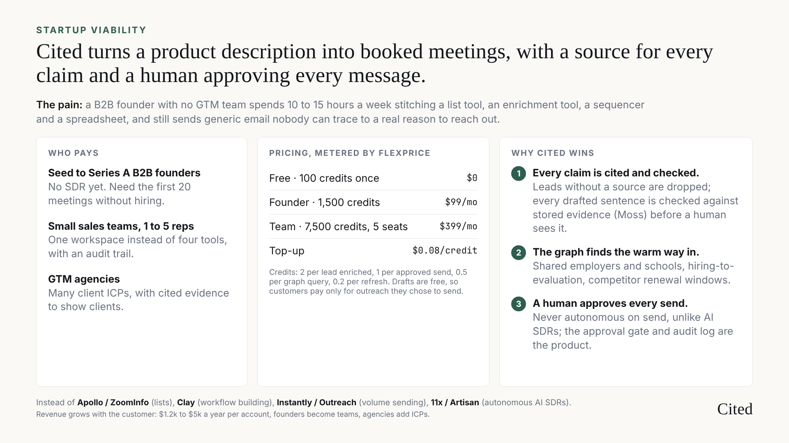

# Cited

**Cited turns a product description into booked meetings, with a source for every claim and a human approving every message.**

A B2B founder with no GTM team describes their product. Cited infers the ideal customer profile, discovers companies with a cited source for every lead and signal, enriches contacts, finds warm paths through a knowledge graph, drafts outreach that is checked sentence by sentence against stored evidence, and sends nothing until a person approves it.

- Pitch slide: [docs/slides/viability.png](docs/slides/viability.png)
- System design: [docs/system-design.md](docs/system-design.md)
- Demo video script: [docs/demo-script.md](docs/demo-script.md)



## Features

| Feature | What it does | Where |
|---|---|---|
| Intake and ICP | Product chat → NAICS codes, size, personas, triggers, each with a confidence score; suggests adjacent segments with evidence | `lib/pipeline/icp.ts`, `app/intake` |
| Discovery with citations | Tavily search; every lead and signal links to a page search returned, leads without a source are dropped; negative signals filter companies | `lib/pipeline/discovery.ts`, `citations.ts` |
| Scoring and tiers | `score = 0.6·fit + 0.4·intent`, Tier A ≥ 75, B ≥ 55 | `lib/pipeline/scoring.ts` |
| Enrichment | Hunter verifies email and MX; Apollo fills LinkedIn, HQ and career history when Hunter misses. Every field shows its source | `lib/pipeline/enrich.ts` |
| Knowledge graph | Neo4j (in-memory fallback) with three multi-hop queries: warm path, hiring-to-evaluation, competitor displacement | `lib/graph/*`, `app/graph` |
| Scheduled refresh | Signals refresh every 6 hours, re-tier leads, withdraw drafts on negative signals | `lib/pipeline/refresh.ts`, `vercel.json` |
| Outreach and claim check | Grounded drafts; every sentence is checked against evidence in Moss; unsupported claims block approval (`422 UNCITED_CLAIM`) | `lib/pipeline/outreach.ts`, `evidence.ts` |
| Human approval | Batch approval cards, per-message reject reasons back to @builder, schema change approvals | `lib/pipeline/decide.ts`, `components/ApprovalCards.tsx` |
| Pipeline and analytics | Drag-and-drop Kanban, agent/rep attribution, conversion by industry, tier and A/B variant | `app/pipeline`, `lib/pipeline/analytics.ts` |
| Audit log | Every action, actor and agent | `app/audit` |
| Metered billing | Credits per paid action, prepaid wallet and top-up, HTTP 402 when credits run out | `lib/pipeline/billing.ts`, `app/billing` |

### Sponsor integrations

| Sponsor | Role in Cited | Adapter |
|---|---|---|
| **Moss** | Evidence memory: grounded drafting, per-sentence claim check in milliseconds, "ask the evidence" search, semantic trigger matching, optional inference | `lib/providers/moss.ts`, `lib/pipeline/evidence.ts` |
| **Band** | Multi-agent room: @planner → @builder → @reviewer → @security → @human handoffs are mirrored as @mentions; humans approve or reject by replying in the room | `lib/providers/band.ts`, `lib/pipeline/bandDecisions.ts` |
| **Flexprice** | Usage metering (lead_enriched 2, outreach_sent 1, graph_query 0.5, signal_refresh 0.2 credits), prepaid wallet, top-up | `lib/providers/flexprice.ts` |
| **Neo4j** | Knowledge graph and Cypher queries | `lib/graph/neo4j.ts` |

## Architecture

See [docs/system-design.md](docs/system-design.md) for the architecture diagram, the graph ontology, every Cypher query with example output, and the agent reasoning loops.

In short: Next.js App Router pages call API routes; routes call pipeline modules; pipeline modules call vendor adapters in `lib/providers/`. Adapters use fixtures only in demo mode. State lives in a workspace store; the graph is mirrored to Neo4j after every change.

## Quick start

Cited has two modes, and they never share data.

**Live mode (default): real data only.** Put your keys in `.env.local`, then run:

```bash
npm install
cp .env.example .env.local   # add your keys
npm run dev
```

Open http://localhost:3000/overview. Describe your product on **Intake & ICP**, approve the ICP, then click **Run the loop** in the top bar. It runs discovery, enrichment, drafting and the claim check, then stops at your approval: sends always need a human. A live canvas shows each step while an agent is running, and closes when it's done.

There is no seeded data and no silent mock in live mode. If a data key is missing (Claude, Tavily, Hunter or Apollo), that step fails with a message naming the key. Neo4j, Flexprice and Band fall back to local equivalents that run on the same real data until their keys are set. The landing page is at http://localhost:3000.

**Demo mode: the recorded demo and the E2E tests.** `CITED_FORCE_MOCK=true` runs every vendor on fixtures with fictional `.example` companies, keeps its own workspace file (`.data/demo-workspace.json`), and shows **Load demo data**. The **Demo** tab in the app plays a recording made this way. To re-record it:

```bash
npm run build
CITED_FORCE_MOCK=true SENDING_ENABLED=false npx next start -p 3200
BASE=http://localhost:3200 npm run record-demo   # writes public/demo/cited-demo.webm and chapters.json
```

## Environment variables

| Variable | Vendor | Where to get it |
|---|---|---|
| `LLAMA_API_KEY`, `LLAMA_MODEL`, `LLAMA_BASE_URL` | LLM (Meta Llama, default for every agent) | llama.developer.meta.com |
| `ANTHROPIC_API_KEY`, `ANTHROPIC_MODEL` | LLM fallback (Claude, used only if Llama and Moss fail or have no key) | console.anthropic.com |
| `MOSS_PROJECT_ID`, `MOSS_PROJECT_KEY`, `MOSS_INDEX` | Evidence memory | portal.usemoss.dev |
| `TAVILY_API_KEY` | Search | tavily.com |
| `HUNTER_API_KEY` | Enrichment (primary) | hunter.io → API |
| `APOLLO_API_KEY` | Enrichment (fallback, career history) | apollo.io → Settings → API |
| `SENDGRID_API_KEY`, `SENDGRID_FROM` | Email | sendgrid.com (verified sender) |
| `DEMO_RECIPIENT`, `SENDING_ENABLED` | Safety | Your demo inbox; sending is off unless `true` |
| `FLEXPRICE_API_KEY`, `FLEXPRICE_BASE_URL` | Billing | flexprice.io |
| `BAND_API_KEY`, `BAND_ROOM_ID` | Multi-agent room | band.ai (agent key `band_a_…`) |
| `BAND_PLANNER_KEY`, `BAND_BUILDER_KEY`, `BAND_REVIEWER_KEY`, `BAND_SECURITY_KEY` | Optional per-role agent keys | band.ai |
| `BAND_API_URL`, `BAND_WAKEUP_SECRET` | Band API base, webhook secret | band.ai |
| `NEO4J_URI`, `NEO4J_USER`, `NEO4J_PASSWORD` | Graph | Neo4j Aura Free |
| `NEXT_PUBLIC_SUPABASE_URL`, `NEXT_PUBLIC_SUPABASE_ANON_KEY`, `SUPABASE_SERVICE_ROLE_KEY` | Database | supabase.com |
| `SENTRY_DSN` | Error monitoring | sentry.io → Project → Client Keys |
| `POSTHOG_KEY`, `POSTHOG_HOST` | Funnel analytics | posthog.com → Project settings |
| `CRON_SECRET` | Scheduled refresh | Any random string |

Database: `supabase db push` applies `supabase/migrations/`. The Neo4j schema in `lib/graph/schema.cypher` runs on startup.

## Safety

- Nothing is sent unless a rep approved it. Agents are never autonomous on send.
- Outside production every email goes to `DEMO_RECIPIENT`; `SENDING_ENABLED=false` is a kill switch.
- LinkedIn messages are drafted only. The rep sends them by hand and clicks "Mark sent".
- No scraping behind logins. Every lead and signal must cite a URL that search returned.
- Every drafted sentence is checked against stored evidence; a claim without a source cannot be approved.
- Graph schema changes proposed by agents are limited to `CREATE CONSTRAINT|INDEX … IF NOT EXISTS` and wait for a human.
- Keys live only in `.env.local`, which is gitignored.

## Tests and CI

```bash
npm test            # vitest: 85 tests, one file per build stage plus Moss
npm run coverage    # same, with coverage of lib/ (fails under 80% lines; currently about 88%)
npm run e2e         # build, then Playwright walks the full pipeline in mock mode
npm run typecheck
npm run lint
```

Vendor APIs that need keys (Flexprice, Band, Sentry, PostHog) are tested against stubbed HTTP that follows their public docs.

The E2E run drives the UI from intake to ICP approval, discovery (every company must cite a URL), enrichment (credits drop), drafting, one human approval sent to the demo inbox, and the Kanban. A second test adds an unsupported "Series D" claim and checks it is blocked, then drains credits and checks for 402.

GitHub Actions (`.github/workflows/ci.yml`) runs three jobs:

- lint, typecheck, tests with coverage, and build;
- Snyk Open Source and Snyk Code, failing on high severity (set the `SNYK_TOKEN` repository secret), plus `npm audit --audit-level=high`;
- the Playwright E2E with every vendor mocked and sending off.

## Monitoring

| Tool | Tracks | Without keys |
|---|---|---|
| Sentry (`SENTRY_DSN`) | Unhandled API errors and vendor failures (5xx, 401/403, 429, network) | Server log |
| PostHog (`POSTHOG_KEY`) | Funnel: `intake_done`, `icp_approved`, `lead_enriched`, `message_approved`, `stage_changed` | Counts in memory |
| `/api/health` | Vendor modes, per-vendor call and error counts, funnel counts, active alerts | Always on |
| Audit log | Every outbound action (source of truth) | Always on |

Alerts fire, and go to Sentry when it is set, when a vendor's error rate passes 10% (at least 5 calls), when 5 or more 402 responses arrive within 10 minutes, and on any attempt to send a message that was not approved. That last one is also a hard block in `markSent`.

## Project structure

```
e2e/                 Playwright end-to-end tests
app/                 pages (intake, discovery, graph, outreach, pipeline, analytics, billing, audit) and API routes
components/          UI, approval cards, refresh button
lib/
  providers/         llm, moss, tavily, hunter, apollo, sendgrid, flexprice, band (each with a mock fallback)
  pipeline/          icp, discovery, citations, scoring, enrich, evidence, outreach, review, decide,
                     refresh, analytics, billing, credits, team, bandDecisions
  agents/            reviewer, security and shared rules (planner and builder steps run in the pipeline)
  graph/             model, queries (Cypher + in-memory), neo4j sync, schema.cypher
  seed/              demo fixtures (fictional .example companies)
  db/                workspace store
  monitor.ts         Sentry, PostHog, alert counters
supabase/migrations/
docs/                system design, viability slide, demo script
tests/
vercel.json          cron schedule
```

## Build status

| Stage | Scope | Status |
|---|---|---|
| P0 | Skeleton, schema, adapters with mocks, demo seed, app shell | Done |
| P1 | Intake → ICP → discovery with citations → competitors → scoring | Done |
| P2 | Enrichment, sequences, HITL queue, demo-inbox send, manual LinkedIn | Done |
| Moss | Evidence memory, grounded drafting, claim check, evidence search, semantic triggers, Moss Inference | Done |
| P3 | Kanban, attribution, audit, analytics | Done |
| P4 | Neo4j graph, 3 multi-hop queries, scheduled refresh | Done (in-memory until Neo4j keys are set) |
| P5 | Flexprice metering and credit gate | Done (mock until FLEXPRICE_API_KEY is set) |
| P6 | Band agents and approval cards | Done (local agents until Band keys are set) |
| P7 | Pitch slide, system design, demo script | Done (video to be recorded) |
| P8 | Snyk in CI, Playwright E2E, 80% coverage, Sentry and PostHog | Done (Snyk runs once `SNYK_TOKEN` is set) |

## License

MIT
