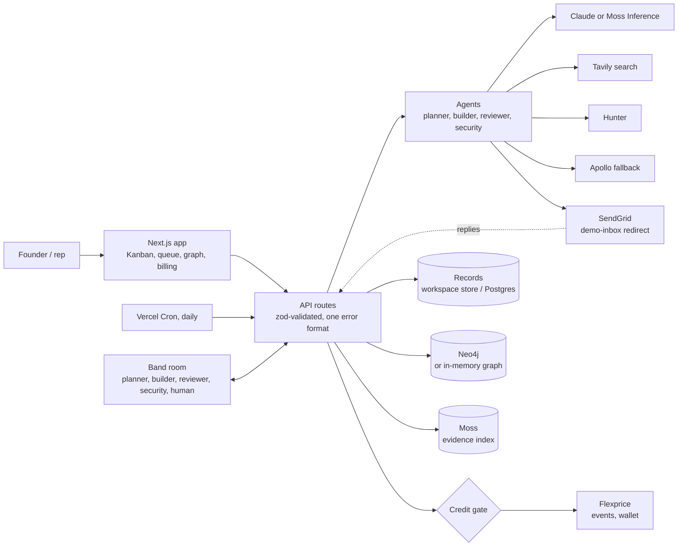
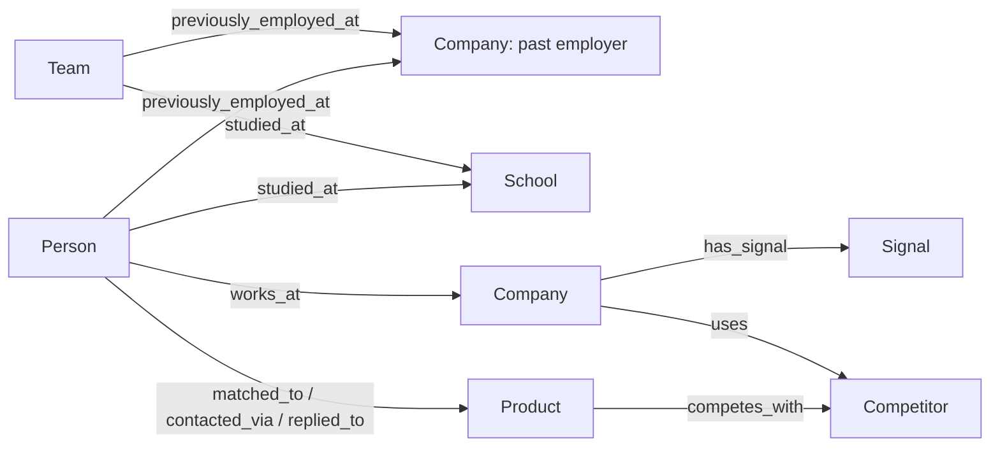

# Cited system design

Cited turns a product description into booked meetings. It infers an ICP, discovers companies with a source for every claim, maps them in a knowledge graph, enriches contacts, drafts outreach grounded in stored evidence, and sends nothing until a human approves it. Four agents (planner, builder, reviewer, security) do the work; a person makes every decision that leaves the building.

## 1. Overview and goals

The loop: **intake → ICP → discovery → graph → enrichment → drafting → human approval → send → pipeline → analytics**, with a scheduled refresh feeding new signals back into scoring.

Safety rules the code enforces, not just the UI:

- **Every lead and signal cites a URL that search returned.** Uncited extractions are dropped (`lib/pipeline/citations.ts`).
- **Every specific claim in a message is backed by stored evidence.** Moss claim check at review and again at approval (`422 UNCITED_CLAIM`).
- **Nothing sends without a human.** Email goes out only after approval; outside production it always goes to `DEMO_RECIPIENT`, and `SENDING_ENABLED=false` is a kill switch. LinkedIn messages are drafted only; the rep sends them by hand.
- **Spend can't run past zero.** A synchronous credit gate before every paid vendor call (`402 CREDIT_LIMIT`).
- **No scraping behind logins.** Only search results and public pages.

## 2. Architecture



- **One Next.js 15 app.** Pages and API routes in `app/`; all vendor calls are server-side, behind adapters in `lib/providers/` that fall back to mocks when a key is missing. The top bar shows which vendors are live.
- **Three stores.** Records (the workspace store; `supabase/migrations/` holds the Postgres schema), relationships (Neo4j, or an in-memory graph built from the records), evidence text (Moss).
- **Boundaries.** The browser never calls a vendor. Every route validates input with zod and returns `{ error: { code, message, details } }` with a fixed set of codes (400, 401, 402, 404, 409, 422, 429, 502).

## 3. Query logic

### Discovery

1. Up to 6 Tavily queries: accepted expansion segments first, then each ICP industry × its two strongest triggers, with the first region.
2. Results deduped by URL.
3. The LLM extracts companies and signals with Zod schema `ProspectSchema`; every URL must be copied from a result.
4. Citation validator (`lib/pipeline/citations.ts`) normalises URLs and drops any company with no URL that search returned; signals with unreturned URLs are dropped too.
5. Negative filter: any `negative` signal, an ICP negative signal found in the signal text, or an excluded region. Filtered companies stay in the grid with the reason and never become leads.
6. Fit + Intent scoring, tier, save. A competitor map is built from a separate search, with the same citation rule.

### Scoring and tiers

`score = round(0.6 × fit + 0.4 × intent)`, both 0–100. Tier A ≥ 75, Tier B ≥ 55, otherwise C. See `lib/pipeline/scoring.ts`.

Fit (0–100) = industry 45 (exact NAICS, scaled by the ICP field's confidence; 25 for same 3-digit sector) + size 30 (15 if within 0.5×–1.5× of the range) + region 25.
Intent (0–100) = per signal type, counted once: hiring 30, tech adoption 30, leadership change 25, funding 25, expansion 25, launch 15; +10 when the signal matches an ICP trigger; ×0.7 after 30 days, ×0.4 after 90.

### Graph queries

The three queries (`lib/graph/queries.ts`, `GET /api/graph/query?q=`; 0.5 credits each)

1. **Warm path**: `(Team)-[previously_employed_at|studied_at]->(x)<-[same]-(Person)-[works_at]->(Company)`. Demo: Maya Chen → Stratus Data → Priya Natarajan (VP Finance, Northwind, the lead's buyer).
2. **Hiring → evaluation**: a company with a `hiring` signal and at least one evaluation trigger (tech adoption, funding, leadership change, expansion), with the lead's buyer. Demo: Northwind (finance data hiring + Series C).
3. **Competitor displacement**: `(Product)-[competes_with]->(Competitor)<-[uses]-(Company)`, joined to the signal that proves it, renewal windows first, with our advantage as the angle. Demo: Corvid Robotics on FloQast, renewing in Q1.

Excluded companies never appear in any query.

**Warm path**

```cypher
MATCH (t:Team)-[r1:previously_employed_at|studied_at]->(x)<-[r2]-(p:Person)-[:works_at]->(c:Company)
WHERE type(r1) = type(r2) AND c.excluded = false AND c.org = $org
OPTIONAL MATCH (p)-[m:matched_to]->(:Product)
RETURN t.name AS team, t.role AS teamRole, x.name AS via, labels(x)[0] AS viaLabel,
       p.name AS person, p.title AS title, c.name AS company, c.id AS companyId, c.tier AS tier,
       m IS NOT NULL AS isBuyer
ORDER BY isBuyer DESC, c.score DESC
```

**Hiring → evaluation**

```cypher
MATCH (c:Company)-[:has_signal]->(h:Signal {type: 'hiring'})
WHERE c.excluded = false AND c.org = $org
MATCH (c)-[:has_signal]->(e:Signal)
WHERE e.type IN ['tech_adoption', 'funding', 'leadership_change', 'expansion']
OPTIONAL MATCH (p:Person)-[:works_at]->(c), (p)-[:matched_to]->(:Product)
RETURN c.name AS company, c.id AS companyId, c.tier AS tier, h.summary AS hiring, h.url AS hiringUrl,
       collect(DISTINCT e.summary) AS evaluation, p.name AS buyer, p.title AS buyerTitle
ORDER BY c.score DESC
```

**Competitor displacement**

```cypher
MATCH (:Product)-[:competes_with]->(k:Competitor)<-[u:uses]-(c:Company)
WHERE c.excluded = false AND c.org = $org
MATCH (c)-[:has_signal]->(s:Signal {id: u.signalId})
OPTIONAL MATCH (p:Person)-[:works_at]->(c), (p)-[:matched_to]->(:Product)
RETURN c.name AS company, c.id AS companyId, c.tier AS tier, k.name AS competitor, u.renewal AS renewal,
       s.summary AS evidence, s.url AS evidenceUrl, k.ourAdvantage AS angle, p.name AS buyer, p.title AS buyerTitle
ORDER BY renewal DESC, c.score DESC
```

Example output (demo data):

| Query | Row |
|---|---|
| warm | Maya Chen (Co-founder) → previously_employed_at → Stratus Data ← Priya Natarajan (VP Finance) → works_at → Northwind Analytics, buyer |
| hiring | Northwind Analytics: "Hiring 3 finance data engineers..." + "Raised a $45M Series C..."; buyer Priya Natarajan |
| displacement | Corvid Robotics uses FloQast, renewal window; evidence: "contract is up for renewal in Q1"; angle: drafts journal entries, priced by entity |

## 4. Graph ontology

Ontology (`lib/graph/model.ts`, schema in `lib/graph/schema.cypher`). Node ids equal record ids.

| Nodes | Edges |
|---|---|
| Company, Person, Product, Competitor, Signal, Team, School | works_at, competes_with, matched_to, contacted_via, replied_to, previously_employed_at, has_signal, uses, studied_at |

- **Team** comes from the intake's team background (`lib/pipeline/team.ts`: LLM extraction, heuristic parse in mock mode). **Person** career history (past employers, school) comes from Apollo employment history during enrichment, with its source recorded.
- Past employers that aren't prospects become `Company` nodes with id `org_<slug>`; spelling variants ("Stratus Data, Inc.") collapse to one node.
- `uses` is derived from signals that name a non-status-quo competitor; `renewal` is set when the signal mentions a renewal.
- **Engine.** With `NEO4J_*` set, the graph is mirrored to Neo4j after discovery, enrichment, refresh and seeding (delete this org's nodes, then batched `UNWIND … MERGE` per label and edge type), and queries run as Cypher scoped by `$org`. Without keys, or if Neo4j fails, the same query runs over the in-memory graph with the same row shape, and the response says which engine answered.



Constraints: a uniqueness constraint on `id` for every label and an index on `Company.domain` (`lib/graph/schema.cypher`, run once per process with `IF NOT EXISTS`). Node ids equal record ids, and every Neo4j node carries `org`, so queries are scoped per workspace.

## 5. Reasoning loops

### ICP inference

The intake (chat or form) goes to the LLM, which returns industries with NAICS codes, size, regions, personas, triggers and negative signals, each with a confidence score. Expansion segments are proposed only with search evidence. The founding team's past employers and schools are extracted from the team background for warm paths. A human approves or edits the ICP (and accepts, adjusts or dismisses each expansion) before discovery can run.

### Discovery

Search → extract → cite-check → negative filter → score → graph write and Moss indexing → semantic trigger matching → re-score. See section 3.

### Enrichment

Per company, best score first, with a 2-credit check before each lead: Hunter Company (HQ) → Apollo Org if missing; Hunter Domain Search to pick the buyer (ICP persona match, then seniority); Hunter Email Finder + Verifier; Apollo People Match only for a missing or invalid email or a missing LinkedIn URL (Apollo emails are re-verified by Hunter). Each field stores the step that filled it (`hunter` or `apollo`). Invalid emails are never kept; a lead without an email gets no email touches.

### Outreach

1. @builder drafts 3 touches: email (day 0), LinkedIn note (day 2), email (day 5). Variant A angle = time saved, B = risk reduced (alternating per lead).
2. @reviewer (`lib/agents/reviewer.ts`): touch 1 cites a real signal id; ≤80 words for C-level, ≤120 otherwise, ≤60 for LinkedIn; one question; no dashes or buzzwords. Fixes go back to @builder, max 2 rounds, then escalate (`needs_fix`).
3. @security (`lib/agents/security.ts`): links only to cited domains; no email addresses or secrets in copy.
4. @human approves, edits or rejects. Approving an email sends it through SendGrid to `DEMO_RECIPIENT` (simulated unless `SENDING_ENABLED=true`), charges 1 credit, and moves the lead Matched → Contacted tagged *agent*. Approving a LinkedIn note only queues it; the rep copies it, sends by hand and clicks "Mark sent", which moves the lead tagged *rep*.
5. SendGrid Inbound Parse posts replies to `/api/webhooks/sendgrid?token=CRON_SECRET`; a reply moves the lead to Replied.

Moss grounds both ends: @builder drafts from the company's strongest evidence, and the claim check runs on every sentence at review and again at approval, including after a rep's edit.

### Pipeline and attribution

- Five stages: Matched, Contacted, Replied, Meeting Booked, Closed/Lost. Agents move leads automatically (first send moves Matched to Contacted; an inbound reply moves to Replied). Reps drag cards on the Kanban, which calls `PATCH /api/leads/:id/stage`.
- Every move writes a `lead_events` row with `actor` (agent or rep) and a note, sets `lead.owner` to that actor, and writes an audit entry `stage_changed`. The lead history drawer reads `lead_events`.
- Closed/Lost requires `outcome` won or lost (400 otherwise) and takes an optional reason, stored as `lead.closeReason`. Moving a closed lead back out clears both.
- `GET /api/analytics?groupBy=industry|tier|variant` (`lib/pipeline/analytics.ts`). Reached stages come from history and are cumulative for open stages, so a lead dragged straight to Meeting Booked still counts as contacted and replied. Reply and meeting rates are over contacted leads; win rate is over closed leads.
- The audit log page filters by actor and action.

### Scheduled refresh

`lib/pipeline/refresh.ts`, called by `GET /api/cron/refresh` (Vercel Cron daily, `CRON_SECRET`) and the "Run refresh now" button (`POST /api/signals/refresh`).

1. Queue: Tier A/B (or the given ids), oldest refresh first, max 50.
2. Per company: credit check (1 credit; out of credits → skipped and counted, never a 402 for cron) → fetch fresh signals (live: Tavily + LLM, only results on the company's site, naming its domain, or its full name; demo `.example` companies use fixtures) → add only new, cited signals → negative filter. A new negative signal marks the company filtered and withdraws its unsent drafts, with audit entries.
3. Moss re-index, semantic trigger matching, re-score and re-tier. Every tier change is audited (`tier_changed`). Demo: Halcyon gets a growth round and moves Tier B → A.
4. Graph mirror.

Demo seed scores now come from the same fit/intent formula, so a refresh only moves a score when the signals change.

## 6. Bonus integrations

### Band (multi-agent collaboration and HITL)

Four roles (planner, builder, reviewer, security) hand work to each other with fixed-shape lines (`@builder TASK discover  icp=v1 ...`, `@reviewer READY drafts ...`, `@builder FIX ...`, `@security READY ...`, `@human APPROVAL ...`). Every handoff is an `agent_events` row, shown in the Agent Thinking panel.

**Band room (`lib/providers/band.ts`).** With `BAND_API_KEY` (an agent key) and `BAND_ROOM_ID`, every agent event is mirrored into the room as it is written:
- A handoff to another participant becomes a real message with a structured `mentions` entry (Band only delivers to mentioned participants). Room participants are matched to roles by name ("Cited Builder" → builder); the human is the room's user.
- Anything without another participant to address becomes a room event (`task` / `thought`).
- Approval requests also post a blocking `attention` event (`kind: review`).
- Optional `BAND_<ROLE>_KEY` lets each role speak as its own agent; otherwise all roles share one key and label themselves.

**Human decisions in the room.** A person replies to one of our agents, for example `approve b_1`, `approve b_1 except msg_x (too long for a CFO)`, `reject msg_x <reason>`, `edit msg_x subject: ...`, `reject apr_schema_1 <reason>`. Cited reads them with the Agent API queue (`messages/next` → `processing` → `processed`/`failed`), answers in the room, and ignores messages from agents (only a person can approve). Polling runs from the "Check Band for decisions" button, the 6-hourly cron, and `/api/webhooks/band` (Band's wake-up URL, verified with the Standard Webhooks signature or a bearer secret).

**One decision path (`lib/pipeline/decide.ts`).** The queue UI (`POST /api/outreach/:id/review`, `POST /api/approvals/:id`) and Band replies call the same functions, so they write the same `approvals`, `audit_log` and `agent_events` rows. Only `audit_log.agent` differs: `ui` or `band:<room>`.
- Outreach batch: reject the listed messages (each goes back to @builder with its reason as a `FIX`), approve the rest (Moss claim check, credit gate, demo-inbox send). The batch closes when nothing in it is waiting.
- Schema change: agents may only propose `CREATE CONSTRAINT|INDEX ... IF NOT EXISTS`. Approve runs it on Neo4j (or records it for the in-memory graph); reject makes @planner re-plan without it. The seed includes @builder asking for an `attended` edge.

Without Band keys the roles run in-process, write the same rows, and the top bar shows "Band: offline (local agents)".

### Flexprice (usage billing)

| Metered event | Credits |
|---|---|
| lead_enriched | 2 |
| outreach_sent (approved send only; drafts are free) | 1 |
| graph_query | 0.5 |
| signal_refresh (per company) | 0.2 |

Plans: Free (100 credits once), Founder $99/month (1,500), Team $399/month (7,500); overage and top-ups at $0.08 per credit.

- **Gate.** `requireCredits` checks the local ledger (`org.creditsBalance`, one decimal) synchronously before every paid vendor call: enrichment, send, graph query. It throws `402 CREDIT_LIMIT`. Scheduled refresh skips and counts instead of failing. The ledger is the gate so a slow billing API can never let spend run past zero.
- **Meter.** `charge` writes a `usage_events` row and sends it to Flexprice `POST /events` with `external_customer_id` = org id and `event_id` = the row id, so retries are deduplicated. Rows that didn't land (`flexprice_synced = false`) are retried by the cron route and by "Sync now" on /billing.
- **Wallet.** On the first top-up or sync with a key, Cited finds or creates the Flexprice customer (`GET /customers/external/{id}`, else `POST /customers`) and a prepaid wallet loaded with the current balance (`POST /wallets`). Top-ups go to `POST /wallets/{id}/top-up` with `PURCHASED_CREDIT_DIRECT` and an idempotency key; /billing shows the wallet's real-time balance (`GET /wallets/{id}/balance/real-time`).
- `POST /api/billing/topup { amount }` (10 to 5,000 whole credits) → `{ balance }`; `GET /api/billing` → balance, plan, prices, usage by event, Flexprice state.

### Moss (evidence memory, sponsor prize)

- **What is indexed.** Every page search returned (company pages, signal sources, competitor pages), each company's firmographics, and our own product description and team, as one Moss index (`cited-evidence`) with metadata `companyId`, `entityType`, `entityId`, `url`, `title`. Product docs use `companyId: "self"` (`lib/pipeline/evidence.ts`).
- **Scoping.** Searches filter to one company plus `self`, so evidence about one prospect never supports a claim about another.
- **Claim check.** Messages are split into sentences; only specific claims (names, numbers, events) are checked. A sentence is supported when a hit scores at least 0.45 and also contains every hard fact in the sentence (funding round, money amount, percentage, year), because similarity alone scores "Series D" close to evidence about a Series C. The UI shows each claim, its source and the query time (single-digit milliseconds in-process).
- **Evidence search.** "Ask the evidence" in the approval queue returns a cited answer.
- **Semantic triggers.** ICP triggers are matched to signals by meaning ("new head of data" matches "hired a VP of Analytics"), which adds intent points.
- **Moss Inference** runs the LLM calls when no Anthropic key is set.
- **Fallback.** If the Moss index can't be loaded, a local engine with the same API answers and the top bar says so.

### Snyk and CI

GitHub Actions runs Snyk Open Source (dependencies) and Snyk Code (SAST) with `--severity-threshold=high` once the `SNYK_TOKEN` secret is set, plus `npm audit --audit-level=high` on every run. PostCSS is pinned to 8.5.33 through an npm override to clear a high-severity advisory in the copy bundled with Next.js 15. The other jobs are lint, typecheck, unit tests with an 80% line-coverage gate on `lib/` (about 88% today), build, and a Playwright E2E that walks the full pipeline in mock mode.

### Monitoring

`lib/monitor.ts` sends unhandled API errors and vendor failures to Sentry (envelope API, `SENTRY_DSN`) and the funnel events `intake_done`, `icp_approved`, `lead_enriched`, `message_approved` and `stage_changed` to PostHog (`POSTHOG_KEY`). Every vendor call goes through `vendorFetch`, which counts calls and failures (5xx, 401/403, 429, network). Alerts fire when a vendor's error rate passes 10% over at least 5 calls, when 5 or more 402s arrive within 10 minutes, and on any attempt to send a message that was not approved; `markSent` refuses that send outright. `/api/health` shows the counters and active alerts with no secrets. Without keys, errors go to the log and funnel counts stay in memory.

## 7. Data model

Records live in the workspace store today. `supabase/migrations/0001_init.sql` defines the Postgres version of most of them; the `team` table and the columns added in P3 to P5 (close reason, career history, Flexprice ids) are still to be migrated.

| Table | Purpose |
|---|---|
| orgs | Workspace, credit balance, plan, Flexprice customer and wallet ids |
| products, icps, expansions | Intake, versioned ICP with confidences, expansion segments with evidence and status |
| companies, signals, citations | Discovered companies with fit/intent/score/tier, exclusion reason, `domain_source`, `hq_source`, `signals_refreshed_at`; signals; one citation per company, signal and competitor |
| people | Buyer contacts with `email_source`, `linkedin_source`, career history and `history_source` |
| competitors, team | Competitor map; founding team for warm paths |
| leads, lead_events | Stage, outcome, close reason, owner (agent or rep), A/B variant; every stage move with actor |
| messages | 3-touch sequences, review and claim-check results, status, `delivered_to` |
| approvals | Outreach batches, schema changes, ICP; decided via `ui` or `band` |
| audit_log, agent_events, usage_events | Who did what; agent handoffs with tokens and cost; metered usage with Flexprice sync state |

Every enriched field records the vendor that filled it (`tavily`, `hunter`, `apollo`, `website`, `mock`).

## 8. Security and privacy

- **Secrets** live only in environment variables (`.env.local` locally, Vercel env in deploys); `.env.example` lists every variable with no values. No key ever reaches the browser.
- **Outbound safety.** Demo-inbox redirect outside production, `SENDING_ENABLED` kill switch, LinkedIn never automated, security agent blocks links to uncited domains and any email address or key-like string in copy.
- **Webhooks and cron** are authenticated: `CRON_SECRET` bearer for cron, a token for SendGrid inbound, Standard Webhooks signatures (or a bearer secret) for Band.
- **Schema changes** proposed by agents are limited to `CREATE CONSTRAINT|INDEX ... IF NOT EXISTS` and need a human.
- **Live data hygiene.** Demo companies use the reserved `.example` domain and are never searched live; live refresh keeps only results on the company's own site, naming its domain, or its full name, so a same-name company is not attached.
- **PII.** Only business contact data from Hunter and Apollo; nothing is scraped behind a login.
- **Last-line HITL check.** `markSent` refuses any message whose status is not `approved` and raises a `send_without_approval` alert.
- **Planned:** Supabase auth with row-level security per org (the migration defines the tables; the app currently runs single-workspace).

## 9. Limitations and next steps

- LinkedIn stays manual by design.
- Single workspace and single rep; Supabase auth and RLS are next.
- Records are kept in an in-process store persisted to a JSON file (memory-only on Vercel); the Postgres adapter is the next step for multi-instance deploys.
- Long jobs (live discovery takes about a minute) run inside the request; a queue (Inngest or Supabase Edge Functions) is the scale path.
- Apollo on a free plan returns no data, so career history for warm paths needs a paid plan or another source.
- Live verification so far: Claude, Tavily, Hunter, SendGrid and Moss. Neo4j, Flexprice and Band run in fallback mode until their keys are added; their adapters are tested against stubbed APIs that follow the vendors' documentation.
